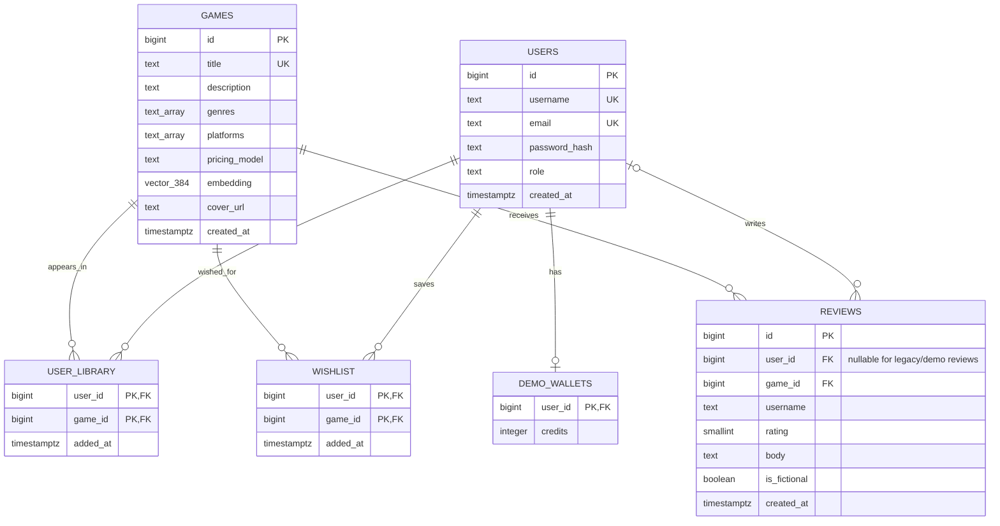
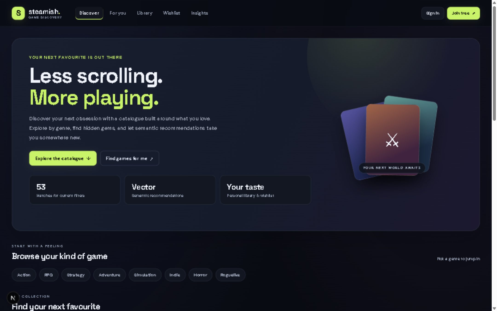
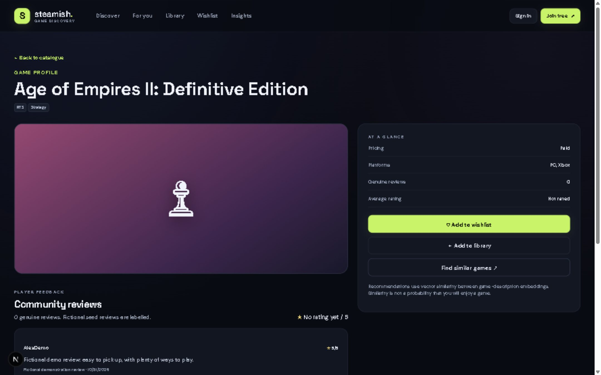
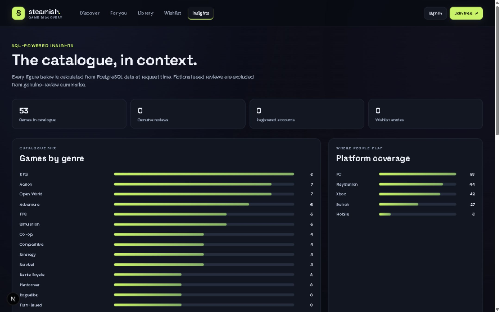
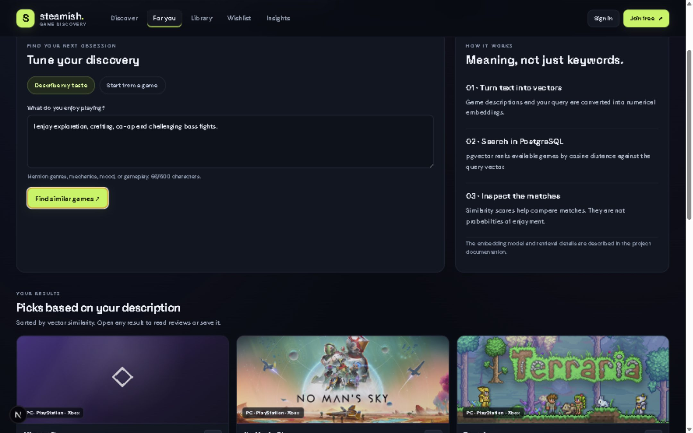

# DBMS Experiential Learning — Level 3 Project Report

**Project:** Steamish — Game Discovery and Semantic Recommendation System\
**Report date:** 31 October 2026

## 1. Project title

**Steamish — Game Discovery and Semantic Recommendation System**

## 2. Student SRNs, names, and contributions

| Student | SRN | Contribution evidenced by the Git history |
|---|---|---|
| Nikhil Tej | PES1UG24AM311 | Implemented the FastAPI application API and the Next.js storefront upgrade, including catalogue discovery, authentication/roles, game pages and reviews, analytics, pgvector recommendations, and related application documentation and tests. Representative commits: `d1dd099`, `2764ef4`, `c931c0c`. |
| Thejas B G | PES1UG24AM306 | Established the initial project foundation: PostgreSQL schema and seed/database modules, embeddings and backend services, the Streamlit application, and subsequent wishlist/backend database work, SQL demonstrations/tests, and ER/schema documentation. Representative commits: `44b211d`, `3102f2f`, `b1a2930`, `4becc47`. Thejas also reviewed and approved later application PRs. |

This division is based on commit authorship and PR history and has been confirmed by the team. Review/approval activity is identified separately from implementation commits.

## 3. Abstract

Steamish is a game-discovery web application built around a PostgreSQL catalogue. Players can search and filter structured game metadata, read and submit reviews, maintain a wishlist and library, view catalogue analytics, and request content-based recommendations. A Next.js interface communicates with a FastAPI backend; PostgreSQL stores the relational data and pgvector stores 384-dimensional game-description embeddings for cosine-similarity retrieval. The project combines relational integrity and SQL queries with vector search rather than using an unrelated database solely to demonstrate a second technology. It is an academic game-discovery prototype: it does not distribute game files, process payments, or connect to a commercial storefront.

## 4. Problem statement, motivation, objectives, and scope

### Problem statement

When a catalogue contains games with varied genres, platforms, and descriptions, browsing only by exact keywords or a single category can make discovery difficult. The project provides structured filters and a semantic recommendation path so users can explore games by both explicit attributes and descriptive interests.

### Objectives

- Design and implement a relational PostgreSQL schema with keys, constraints, relationships, and useful indexes.
- Provide a Next.js web interface connected to the database through an API layer.
- Support account registration/sign-in, role-aware administration, reviews, wishlists, and libraries.
- Demonstrate SQL joins, aggregation, transactions, constraints, views, and index-backed queries.
- Store text embeddings in pgvector and retrieve similar games using cosine distance.
- Provide database-backed catalogue analytics and reproducible setup/test instructions.

### Scope and limitations

The seeded catalogue contains 53 game records and fictional demonstration reviews. The application stores game metadata and review text, not game binaries or payments. The existing Streamlit interface remains as a learning prototype/fallback; the Next.js application is the primary web interface. Email verification, password recovery, rate limiting, review moderation, production deployment hardening, monitoring, and backup automation are not implemented.

## 5. Technology stack

| Layer | Technology | Use |
|---|---|---|
| Web interface | Next.js 16.4.3, React 19.3, TypeScript | App Router pages, forms, catalogue, dashboards, and server-side API proxy |
| Backend/API | Python 3.11, FastAPI, Uvicorn, Psycopg 3 | HTTP endpoints, validation, authentication, authorization, and database access |
| Relational database | PostgreSQL | Catalogue, users, reviews, collections, constraints, views, and SQL analytics |
| Vector capability | pgvector | 384-dimensional game embeddings and cosine-similarity search within PostgreSQL |
| Embeddings | Sentence Transformers `sentence-transformers/all-MiniLM-L6-v2` | Encodes game metadata and free-text recommendation queries; deterministic hashed-token fallback exists if the model cannot load |
| Configuration | `.env` and `web/.env.local` (local-only) | Database URL, session secret, and frontend API URL configuration; examples are provided in the repository |
| Legacy prototype | Streamlit, optional Redis cache | Preserved learning prototype; PostgreSQL remains the source of truth |

## 6. Database choices and justification

The project uses **Option 2: SQL + Vector Database** from the course requirements. PostgreSQL is the mandatory relational database and pgvector supplies vector storage/search as a PostgreSQL extension. No separate MongoDB, Neo4j, or other NoSQL service is used.

Relational tables suit catalogue attributes and account-owned relationships because they need constraints, joins, and consistent multi-row writes. Game descriptions and the user's taste prompt are text-heavy; embeddings make it possible to retrieve semantically related games when the wording differs from catalogue keywords. Keeping vectors in PostgreSQL allows the API to combine metadata filters and relational data with vector similarity without introducing a second operational database.

## 7. System architecture

```text
Browser
  │ Next.js pages and components
  ▼
Next.js catch-all route handler: /api/*
  │ forwards request and session cookie to STEAMISH_API_URL
  ▼
FastAPI: backend/http_api.py
  │ Psycopg, parameterized SQL, transactions, role checks
  ▼
PostgreSQL + pgvector
  ├── relational catalogue and user data
  ├── SQL views, constraints, and indexes
  └── games.embedding vector(384)
```

Database credentials are read by the backend from environment configuration and are not sent to browser code. Sessions use a signed, HttpOnly cookie. The FastAPI service is intended to bind to localhost for local development; public deployment requires additional security review.

## 8. Database design

### ER diagram

The canonical diagram is maintained in [`ER_DIAGRAM.md`](ER_DIAGRAM.md) and reflects `sql/schema.sql` plus the application migration.



### Relational schema

- `GAMES(id PK, title UQ, description, genres, platforms, pricing_model, embedding, cover_url, created_at)`
- `USERS(id PK, username UQ, email UQ nullable for legacy demo users, password_hash, role, created_at)`
- `REVIEWS(id PK, user_id FK nullable, game_id FK, username, rating, body, is_fictional, created_at)`
- `USER_LIBRARY(user_id PK/FK, game_id PK/FK, added_at)`
- `WISHLIST(user_id PK/FK, game_id PK/FK, added_at)`
- `DEMO_WALLETS(user_id PK/FK, credits)`

### Data dictionary and integrity rules

| Table | Important attributes and meaning | Keys/constraints |
|---|---|---|
| `games` | `title`, `description`, `genres TEXT[]`, `platforms TEXT[]`, `pricing_model`, optional HTTP(S) `cover_url`, `embedding vector(384)`, `created_at` | Primary key `id`; unique title; title length check; GIN indexes on genre/platform arrays; HNSW cosine index for non-null embeddings |
| `users` | `username`, optional `email`/`password_hash` for legacy demo users, `role` (`player` or `admin`), `created_at` | Primary key `id`; username uniqueness; case-insensitive unique indexes for username/email; role CHECK constraint |
| `reviews` | reviewer display-name snapshot, rating, body, fictional/demo flag, optional authenticated `user_id`, `game_id`, timestamp | Primary key `id`; FKs to users/games; rating 1–5 and body length 5–1000 checks; partial unique index for one authenticated review per user/game |
| `user_library` | Account-owned game collection and `added_at` | Composite primary key `(user_id, game_id)`; FKs cascade on deletion |
| `wishlist` | Account-owned saved games and `added_at` | Composite primary key `(user_id, game_id)`; FKs cascade on deletion |
| `demo_wallets` | Legacy prototype demonstration credit balance | `user_id` is primary key/FK; credits CHECK prevents negative balances |

`game_review_summary` is a view that aggregates genuine review counts and average ratings while excluding fictional seed reviews. Reviewer deletion sets a review's nullable `user_id` to NULL; game deletion cascades its reviews. The full DDL is in [`sql/schema.sql`](../sql/schema.sql) and [`sql/migrations/001_application_features.sql`](../sql/migrations/001_application_features.sql).

## 9. SQL database commands and operations

### Database setup commands

From PowerShell, connect to PostgreSQL's maintenance database:

```powershell
psql -U postgres -h localhost -p 5432 -d postgres
```

At the `postgres=#` prompt, list databases and run `CREATE DATABASE` only if `game_catalog` is absent:

```psql
\l
CREATE DATABASE game_catalog;
\connect game_catalog
CREATE EXTENSION IF NOT EXISTS vector;
\q
```

The application setup then uses the documented `DATABASE_URL`, initializes the schema/seeds, and applies the application migration:

```powershell
python -m backend.init_db
psql -U postgres -d game_catalog -v ON_ERROR_STOP=1 -f sql/migrations/001_application_features.sql
```

### DDL and DML examples

The schema uses `CREATE TABLE`, primary/foreign keys, CHECK/UNIQUE constraints, and indexes. The application migration uses `ALTER TABLE` and creates a view/indexes. Example DDL from the schema:

```sql
CREATE TABLE IF NOT EXISTS wishlist (
    user_id BIGINT NOT NULL REFERENCES users(id) ON DELETE CASCADE,
    game_id BIGINT NOT NULL REFERENCES games(id) ON DELETE CASCADE,
    added_at TIMESTAMPTZ NOT NULL DEFAULT now(),
    PRIMARY KEY (user_id, game_id)
);

ALTER TABLE games ADD COLUMN IF NOT EXISTS cover_url TEXT;
```

Representative application operations include parameterized `SELECT` for catalogue search, `INSERT` for accounts/reviews/wishlist/library entries, `UPDATE` for reviews and administrator-edited games, and `DELETE` for collection entries/catalogue records. Review writes use `INSERT ... ON CONFLICT ... DO UPDATE`; collection writes use `ON CONFLICT ... DO NOTHING` to preserve uniqueness.

Analytics and demonstrations use joins, aggregation, `GROUP BY`, `HAVING`, `ORDER BY`, subqueries, `UNNEST`, `COUNT`, and `AVG`. For example:

```sql
SELECT g.title, ROUND(AVG(r.rating)::numeric, 2) AS average_rating,
       COUNT(r.id) AS review_count
FROM games g
JOIN reviews r ON r.game_id = g.id AND r.is_fictional = FALSE
GROUP BY g.id, g.title
HAVING COUNT(r.id) >= 2
ORDER BY AVG(r.rating) DESC, COUNT(r.id) DESC, g.title;
```

Transactions are used for related writes. `sql/queries.sql` demonstrates `BEGIN`/`ROLLBACK` for wallet updates, wishlist operations, and deletion tests so sample data is restored. `DROP DATABASE` was used only to clean up the isolated README setup-test database after it passed; no application table or `game_catalog` was dropped. The test database was removed. This is the equivalent cleanup command; **never run it against `game_catalog`**:

```sql
DROP DATABASE steamish_readme_test_20261031;
```

The complete query examples are in [`sql/queries.sql`](../sql/queries.sql).

## 10. NoSQL / Vector database commands and retrieval

The vector component is **pgvector in PostgreSQL**, not a separate NoSQL database. The base schema enables the extension, defines a 384-dimensional vector column, and creates an HNSW index using the cosine operator class:

```sql
CREATE EXTENSION IF NOT EXISTS vector;
-- games.embedding is declared as vector(384) in sql/schema.sql
CREATE INDEX IF NOT EXISTS games_embedding_hnsw_idx
    ON games USING hnsw (embedding vector_cosine_ops)
    WHERE embedding IS NOT NULL;
```

Game titles, descriptions, genres, and platforms are combined into text and encoded using `sentence-transformers/all-MiniLM-L6-v2`. A free-text taste description is encoded with the same model. If the model cannot load, `backend/embeddings.py` falls back to a deterministic hashed-token vector; this fallback is not the learned Sentence Transformer model.

The API orders candidates by pgvector cosine distance (`<=>`) and returns `1 - distance` as a similarity score. Simplified form of the parameterized retrieval used by the API:

```sql
SELECT id, title, 1 - (embedding <=> %s::vector) AS similarity
FROM games
WHERE embedding IS NOT NULL
ORDER BY embedding <=> %s::vector, title
LIMIT %s;
```

The score is a relative similarity measure, not a probability of user satisfaction. Query generation and filtering are implemented in `backend/http_api.py` and demonstrated in `sql/queries.sql`.

## 11. Next.js project tree structure

Key source structure (generated files, dependencies, and artwork assets omitted):

```text
web/
├── app/
│   ├── admin/page.tsx
│   ├── analytics/page.tsx
│   ├── api/[...path]/route.ts
│   ├── games/[id]/page.tsx
│   ├── library/page.tsx
│   ├── login/page.tsx
│   ├── recommendations/page.tsx
│   ├── register/page.tsx
│   ├── wishlist/page.tsx
│   ├── globals.css
│   ├── layout.tsx
│   └── page.tsx
├── components/
│   ├── AuthForm.tsx
│   ├── CollectionView.tsx
│   ├── GameCard.tsx
│   └── SiteHeader.tsx
├── lib/
│   ├── api.ts
│   └── types.ts
├── .env.example
├── next.config.ts
└── package.json
```

The Next.js route handler proxies same-origin `/api/*` requests to FastAPI, forwarding the session cookie so the browser does not connect directly to PostgreSQL.

## 12. Application code sample and demo screenshots

### Source code sample

The following excerpt shows the core pgvector retrieval in `backend/http_api.py`; the live code binds the query vector and limit as parameters:

```sql
SELECT g.id, g.title, g.description, g.genres, g.platforms,
       1 - (g.embedding <=> %s::vector) AS similarity
FROM games g
WHERE g.embedding IS NOT NULL
ORDER BY g.embedding <=> %s::vector, g.title
LIMIT %s;
```

Related implementation files: [`backend/http_api.py`](../backend/http_api.py), [`web/app/api/[...path]/route.ts`](../web/app/api/%5B...path%5D/route.ts), and [`web/app/recommendations/page.tsx`](../web/app/recommendations/page.tsx).

### Screenshots of the running application

**Catalogue homepage**



**Game details and reviews**



**Database-backed analytics**



**pgvector recommendations**



## 13. Testing results

Testing was performed on 31 October 2026. The original `game_catalog` database was not recreated or used for the fresh-initialization test.

| Test | Result |
|---|---|
| `backend.test_http_api` | PASS — 3 authentication-helper tests |
| `backend.test_db` on the existing DB | PASS — schema, pgvector dimensions, constraints, FKs, and transaction rollback |
| README fresh database setup | PASS — setup tested in a separate disposable PostgreSQL database; 53 seeded games and 384-dimensional vectors verified; migration applied; `backend.test_db` passed; temporary API health returned `database: connected`; disposable DB dropped afterward |
| Next.js `npm.cmd run lint` | PASS |
| Next.js `npm.cmd run typecheck` | PASS |
| Next.js `npm.cmd run build` | PASS |
| Live catalogue | PASS — 53 games; Action filter 7 matches; search “Hades” 1 match; title-descending sort and page-2 pagination worked |
| Game details/reviews | PASS — details and seed-review labeling displayed; disposable signed-in account submitted and updated a review, then test data was removed |
| Wishlist/library | PASS — disposable account added, viewed, and removed an entry from each; account and test data were removed afterward |
| Authentication and role UI | PASS for registration, login/logout, and player denial at `/admin`; admin create/update/delete operations were not manually exercised as an admin |
| Analytics and pgvector | PASS — database summaries loaded and a natural-language query returned similarity-ranked results |

The temporary test account, review, wishlist, and library data were removed. A post-cleanup check found no matching test account or review. The separate setup-test database was dropped; `game_catalog` remained intact with 53 games and embeddings.

## 14. Evaluation rubric — completion status

| Course criterion | Status | Evidence / qualification |
|---|---|---|
| Meaningful project beyond basic CRUD | Implemented | Catalogue discovery combines structured search/filtering with semantic recommendations and analytics. |
| Two-member team and defined contributions | Documented | Two students and commit-based responsibilities are listed in Section 2; team confirmed the split. |
| PostgreSQL plus a second database paradigm | Complete | PostgreSQL relational data plus pgvector vector search; no separate NoSQL product is used. |
| ER diagram and relational schema | Complete | `docs/ER_DIAGRAM.md`, `sql/schema.sql`, and application migration. |
| DDL, DML, keys, constraints, indexes, views | Implemented | Schema and migration demonstrate these; a disposable test database was dropped as cleanup, not project data. |
| Meaningful SELECT/INSERT/UPDATE/DELETE and advanced SQL | Implemented and tested | Application APIs and `sql/queries.sql` demonstrate DML, joins, aggregates, subqueries, transactions, and rollback. |
| At least four advanced database concepts | Complete | Transactions, row locking in the legacy transfer service, indexes (GIN/B-tree/HNSW), a view, constraints, and vector similarity search. |
| Functional Next.js web application and API integration | Complete | Next.js App Router, FastAPI, PostgreSQL, and environment-based configuration. |
| Authentication and at least two roles | Implemented; partial role-flow testing | `player` and `admin` roles are enforced in the API; player denial was tested, but an admin write workflow was not. |
| Validation, integrity, and password/session protection | Implemented and partially tested | Pydantic/API validation, PostgreSQL constraints, salted PBKDF2 password hashes, signed HttpOnly cookie, parameterized SQL. Production hardening remains future work. |
| Fresh database initialization and migration | Tested | Completed in a separate disposable database and cleaned up; existing `game_catalog` was not reset. |
| Automated and live test results | Recorded | Results are listed in Section 13; admin writes and fresh dependency installation were not tested. |
| Application code sample/demo screenshots | Included | Section 12 provides a source-code excerpt with implementation links and four genuine application screenshots. |
| README setup instructions | Tested in part | Database setup/migration and temporary API health were tested; a clean install of all Python/Node dependencies was not repeated. |
| Team formation / instructor approval | Confirmation required | Two team members are identified; instructor approval is not independently evidenced in the repository. |
| Individual contributions | Team-confirmed; commit evidence cited | Commit history supports the described work split, which was confirmed by the team. |
| Project originality / uniqueness within section | Confirmation required | The report does not claim to independently verify originality or uniqueness against other teams. |

## 15. Conclusion and future enhancements

Steamish demonstrates a connection between relational database design, SQL integrity/analytics, pgvector retrieval, and a functional Next.js application. Core catalogue, account, review, collection, analytics, and recommendation flows were tested locally, and fresh database setup was verified without risking the existing database.

Future work could add email verification and password recovery, rate limiting, review moderation, audit logging for administrator changes, more extensive admin-role end-to-end tests, automated browser tests, and production monitoring/backup procedures. The current application is an academic prototype, not a production storefront.
