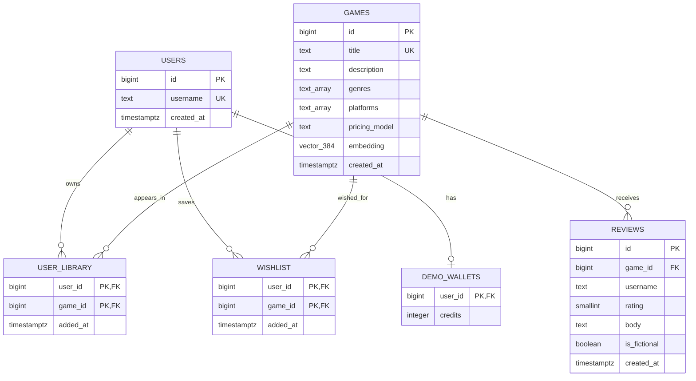

# Steamish ER diagram

The diagram below mirrors `sql/schema.sql`.

Notes:
- `user_library` and `wishlist` use composite primary keys `(user_id, game_id)`, preventing duplicate entries.
- Reviews are associated with a game and retain a display-name string for the reviewer; there is no account/authentication relationship for reviewers in this learning project.
- All foreign keys to users/games cascade on delete.
