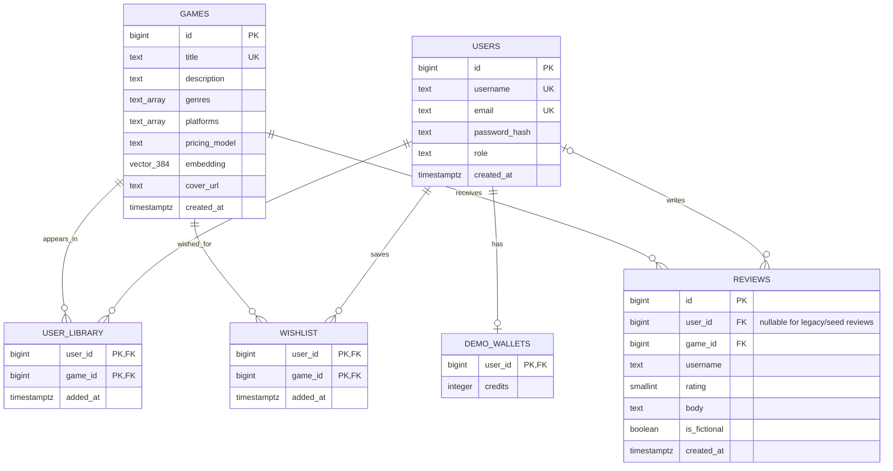

# Steamish ER diagram

This diagram reflects `sql/schema.sql` plus the application-specific migration at `sql/migrations/001_application_features.sql`. Re-export/update it if the schema changes again.

## Notes

- `users.username` and `users.email` are protected by case-insensitive unique indexes. Existing demo users have no email or password hash and cannot sign in until a real account is registered.
- `user_library` and `wishlist` use composite primary keys `(user_id, game_id)`, preventing duplicate entries for a given account.
- New reviews reference an authenticated user through nullable `reviews.user_id`. The username field remains a display-name snapshot. Legacy and fictional seed reviews may have `user_id = NULL`.
- `reviews_user_game_uq` allows one review per registered user/game pair; posting again updates the existing review.
- Game metadata has an optional `cover_url`. Embeddings remain stored in pgvector as 384-dimensional vectors.
- `ON DELETE CASCADE` is used for library/wishlist links and game reviews; reviewer account deletion sets `reviews.user_id` to null so the review record can remain attached to the game.
